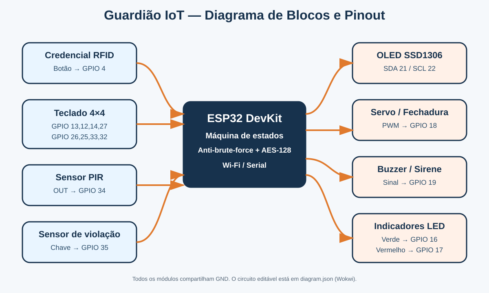

# Guardião IoT: Sentinela Inteligente para Controle de Acesso

> Projeto prático de IoT e Segurança da Informação desenvolvido na disciplina de Algoritmos e Estrutura de Dados (CESAR School).

## 👥 Integrantes da Equipe

- joao victor santos branco de barros (joao.branco@upe.br/ joaobranco-sys)
- Nome Completo 2 (E-mail / GitHub)
- Nome Completo 3 (E-mail / GitHub)
- Nome Completo 4 (E-mail / GitHub)

> Substitua os campos acima pelos dados reais da equipe antes da entrega.

---

## 📖 1. Contexto e História (O Problema)

Salas de servidores, laboratórios, almoxarifados e portarias precisam impedir acessos não autorizados e registrar acontecimentos suspeitos. Uma chave física pode ser copiada, enquanto uma senha isolada pode ser descoberta ou submetida a força bruta. Uma invasão também pode ocorrer sem registro do movimento ou alerta local.

O **Guardião IoT** demonstra uma solução com ESP32 que reúne credencial RFID simulada, senha, detecção de movimento, sinalização visual, alarme sonoro e fechadura por servo. Os eventos são cifrados com AES-128-CBC antes de aparecerem como publicações MQTT simuladas.

No Wokwi, o botão azul representa uma credencial RFID válida. Para facilitar a demonstração, o RFID ou a senha `1234#` podem liberar o acesso individualmente. Em uma implantação física, o fluxo recomendado exige os dois fatores em sequência.

## ⚙️ 2. Funcionalidades do Dispositivo

- [x] Autenticação física com RFID simulado e senha em teclado matricial.
- [x] Estrutura preparada para autenticação de dois fatores (RFID + senha).
- [x] Detecção de movimento com sensor PIR.
- [x] Detecção de mudança da posição segura da chave de violação.
- [x] Cifragem AES-128-CBC da carga antes do envio MQTT/HTTP simulado.
- [x] Bloqueio por 30 segundos após três tentativas incorretas (*anti-brute force*).
- [x] Fechadura por servo com fechamento automático após 10 segundos.
- [x] Alarme de movimento em volume reduzido durante 2 segundos.
- [x] Um bip para acesso correto e dois bipes para senha incorreta.
- [x] LEDs verde/vermelho e display OLED para indicação dos estados.

## 🛠️ 3. Especificações Técnicas e Componentes

- **Microcontrolador:** ESP32 DevKit V1 / NodeMCU-32S (Wi-Fi + Bluetooth).
- **Identificação:** botão azul simulando o leitor RFID RC522.
- **Sensores:** sensor PIR e chave de violação da porta/gabinete.
- **Atuadores:** servo motor, buzzer, LED verde e LED vermelho.
- **Interface:** teclado 4x4 e display OLED SSD1306 I2C de 0,96 polegada.
- **Ambiente:** Wokwi e Visual Studio Code com PlatformIO.
- **Framework:** Arduino para ESP32 em C/C++.
- **Bibliotecas:** Keypad, Adafruit GFX, Adafruit SSD1306, ESP32Servo e mbedTLS.

## 🔌 4. Diagrama de Conexões (Pinout)



O circuito editável está no `diagram.json` e no [projeto do Wokwi](https://wokwi.com/projects/481793318444932097).

| Componente | Pino do componente | Pino no ESP32 | Observações |
| :--- | :--- | :--- | :--- |
| Display OLED | SDA | GPIO 21 | I2C |
| Display OLED | SCL | GPIO 22 | I2C |
| Teclado 4x4 | R1, R2, R3, R4 | GPIO 13, 12, 14, 27 | Linhas |
| Teclado 4x4 | C1, C2, C3, C4 | GPIO 26, 25, 33, 32 | Colunas |
| RFID simulado | Sinal do botão | GPIO 4 | `INPUT_PULLUP` |
| Sensor PIR | OUT | GPIO 34 | Movimento |
| Chave de violação | Sinal central | GPIO 35 | Mudança de posição |
| Servo motor | PWM | GPIO 18 | 0° fechado; 90° aberto |
| Buzzer | Sinal | GPIO 19 | Confirmação e alarme |
| LED verde | Ânodo | GPIO 16 | Acesso autorizado |
| LED vermelho | Ânodo | GPIO 17 | Negado/alarme |

## 🚀 5. Instruções de Compilação e Gravação

### Clonar o repositório

```bash
git clone URL_DO_REPOSITORIO.git
cd Guardiao_IoT
```

Substitua a URL pelo endereço real do repositório.

### Executar no Wokwi

1. Abra o [Guardião IoT no Wokwi](https://wokwi.com/projects/481793318444932097).
2. Confirme os arquivos `sketch.ino`, `diagram.json` e `libraries.txt`.
3. Clique em **Start the simulation**.
4. Aguarde `Guardiao IoT iniciado` no Monitor Serial.
5. Execute os testes da seção 9.

### Compilar e gravar com PlatformIO

1. Instale o VS Code e a extensão PlatformIO IDE.
2. Abra a pasta do projeto e conecte o ESP32 por USB.
3. Execute:

```bash
pio run
pio run --target upload
pio device monitor
```

### Usar a Arduino IDE

1. Instale o pacote de placas ESP32.
2. Instale as bibliotecas de `libraries.txt`.
3. Abra `sketch.ino`, selecione **ESP32 Dev Module** e a porta correta.
4. Clique em **Carregar**.

## 🧠 6. Algoritmo Central

O firmware utiliza uma máquina de estados:

- `AGUARDANDO_RFID`: estado inicial e leitura de RFID/senha.
- `AGUARDANDO_SENHA`: coleta e validação da senha.
- `ACESSO_LIBERADO`: LED verde e servo aberto por 10 segundos.
- `BLOQUEADO`: bloqueio de 30 segundos após três erros.
- `ALARME`: LED vermelho, servo fechado e buzzer por 2 segundos.

O PIR dispara o alarme ao detectar movimento fora de um acesso autorizado. A chave de violação considera a posição encontrada na inicialização como segura e detecta mudanças posteriores.

## 🔊 7. Sinais Visuais e Sonoros

| Situação | LED | Buzzer | Servo |
| :--- | :--- | :--- | :--- |
| Acesso autorizado | Verde | 1 bip agudo de 120 ms | Abre a 90° |
| Uma senha incorreta | Vermelho breve | 2 bipes graves de 110 ms | Fechado |
| Três senhas incorretas | Vermelho | Alarme por 2 s | Fechado |
| Movimento detectado | Vermelho | 1200 Hz por 2 s | Fechado |
| Estado normal | Apagados | Silencioso | Fechado a 0° |

## 🔐 8. Segurança da Informação

Cada evento vira um JSON e é cifrado com AES-128-CBC por meio da mbedTLS. O Monitor Serial mostra o tópico MQTT simulado e a carga cifrada em hexadecimal.

```json
{"evento":"MOVIMENTO_DETECTADO","uptime_ms":12345}
```

> A chave e o IV fixos são apenas didáticos. Em produção, use IV aleatório, armazenamento seguro de chaves, AES-GCM ou HMAC e transporte com TLS.

## 🧪 9. Como Testar

| Teste | Procedimento | Resultado esperado |
| :--- | :--- | :--- |
| RFID válido | Clique em **RFID válido** | LED verde, bip e servo aberto por 10 s |
| Senha correta | Digite `1234#` | LED verde, bip e servo aberto por 10 s |
| Senha incorreta | Digite outra senha e `#` | LED vermelho e dois bipes |
| Anti-brute force | Erre a senha três vezes | Alarme por 2 s e bloqueio por 30 s |
| Movimento | Clique no PIR e em **Simulate motion** | LED vermelho e buzzer baixo por 2 s |
| Violação | Mude a chave de violação | Alarme e evento cifrado |
| Fechamento | Aguarde após acesso válido | Servo retorna a 0° após 10 s |

Senha de demonstração: `1234`.

## ⚠️ 10. Modelo de Ameaças e Limitações

| Ameaça | Mitigação | Limitação atual |
| :--- | :--- | :--- |
| Descoberta da senha | RFID e limite de tentativas | RFID simulado por botão |
| Força bruta | Bloqueio por 30 s | Contador não persiste ao reiniciar |
| Movimento não autorizado | PIR, LED e buzzer | PIR não identifica a pessoa |
| Abertura forçada | Chave de violação | Hardware real requer sensor magnético |
| Interceptação | AES-128-CBC | Chave e IV didáticos |

## 📁 11. Estrutura do Repositório

```text
Guardiao_IoT/
├── README.md
├── sketch.ino
├── diagram.json
├── libraries.txt
├── platformio.ini
├── wokwi.toml
├── LICENSE
└── docs/
    └── diagrama.svg
```

## 📄 Licença

Projeto acadêmico disponibilizado sob a licença MIT. Consulte `LICENSE`.
